# Roads & Realms

A free, non-commercial economy and strategy game written in Rust, in the spirit of the classic road-building games.
Build roads between flags, let carriers move every ware flag by flag, grow an economy from
wood and stone to gold coins, and push your borders with soldiers.

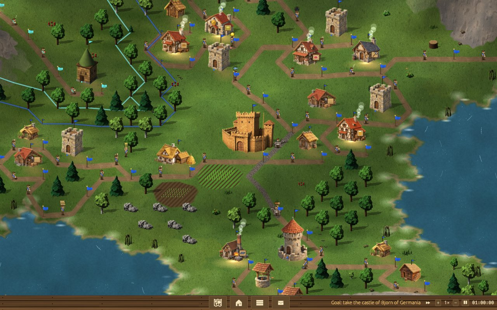

<table>
<tr>
<td>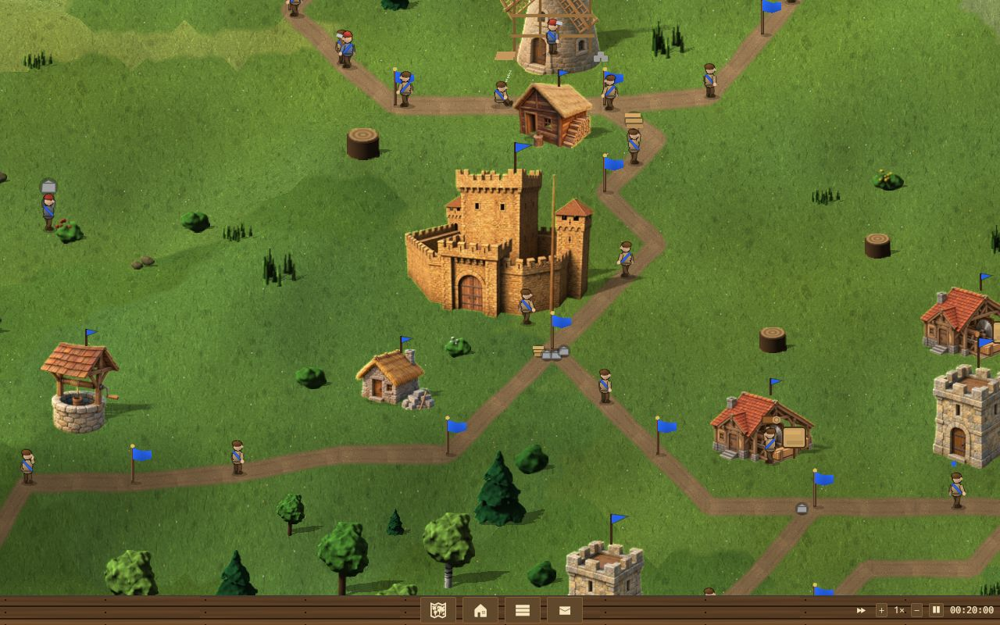</td>
<td>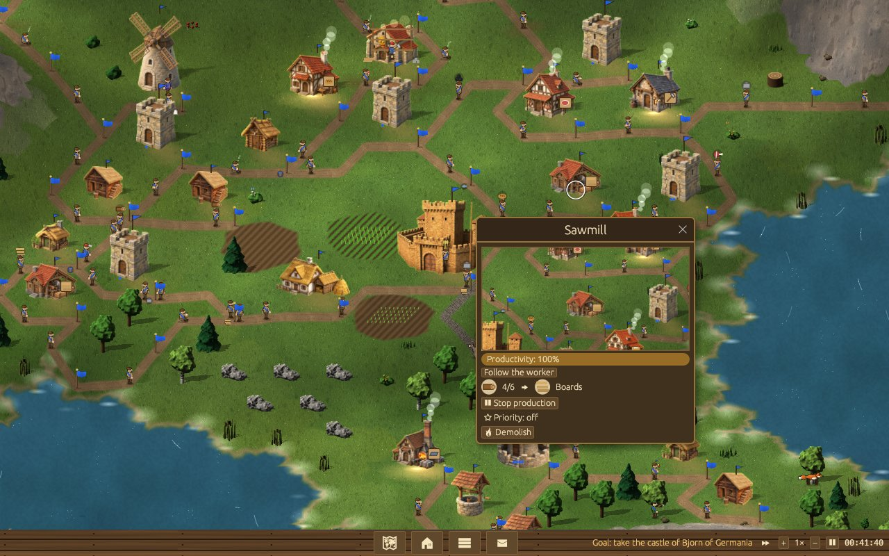</td>
</tr>
<tr>
<td align="center">Every ware travels flag by flag, one carrier per road</td>
<td align="center">Building windows with a live view of the building</td>
</tr>
<tr>
<td>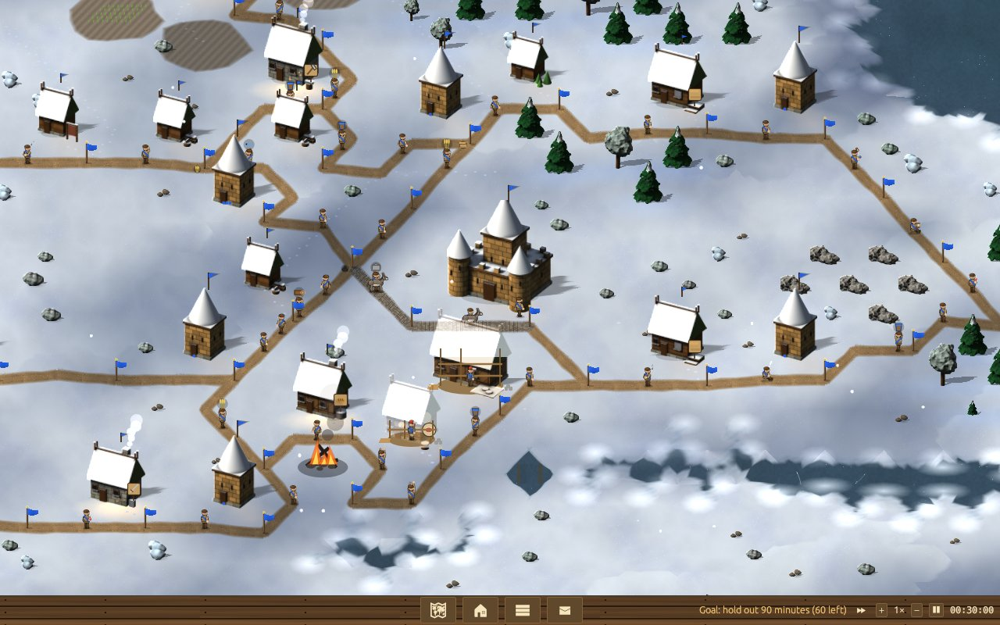</td>
<td>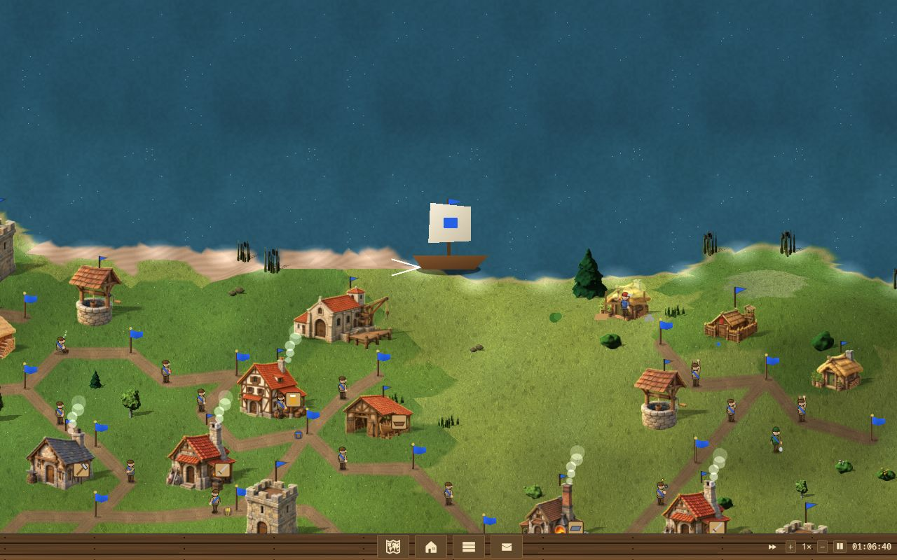</td>
</tr>
<tr>
<td align="center">Winter landscapes</td>
<td align="center">Islands, harbors, expeditions and attacks from the sea</td>
</tr>
<tr>
<td>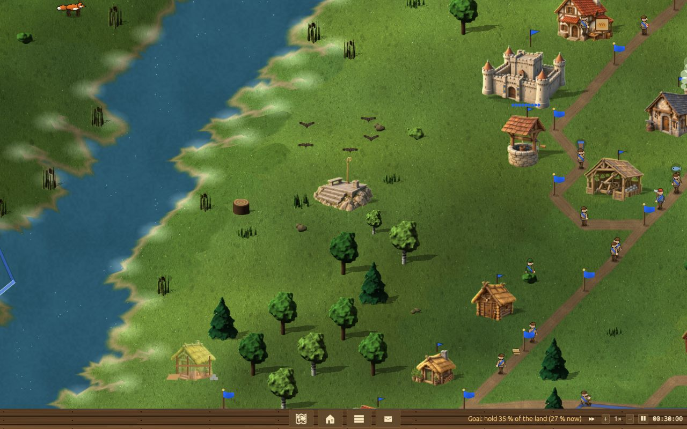</td>
<td>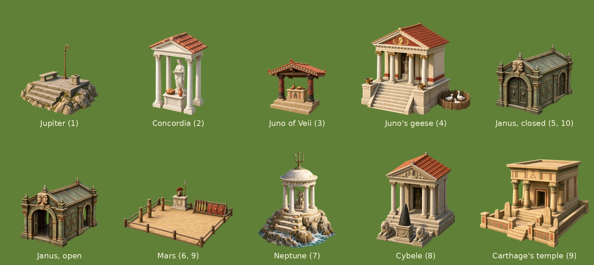</td>
</tr>
<tr>
<td align="center">The Roman campaign: Jupiter's holy place on the Capitol</td>
<td align="center">Holy places of the gods, from the Capitol to Carthage</td>
</tr>
</table>

<p align="center">
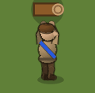
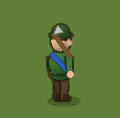
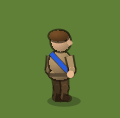
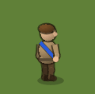
<br><em>Carriers with nothing to do sit down, read, juggle or nap</em>
</p>

- Code: GPL-3.0-or-later (`rr-core`: MIT OR Apache-2.0). Art pack: CC-BY-SA-4.0. Music/sounds: CC0 (see `assets/PROVENANCE.md`).
- No original game data is included or needed. (Loading original `.WLD/.SWD` maps from your own copy works: `--map FILE`.)

## Download

Ready-built games for Linux and Windows (x86_64) are on the
[releases page](https://github.com/csae2414/roads-and-realms/releases): unpack, then start `rr-app`
(`rr-app.exe` on Windows). On Linux, `./install-launcher.sh` adds it to the desktop's app grid.
Saves and settings go to `~/.local/share/roads-and-realms` (Linux) or `%APPDATA%\roads-and-realms` (Windows).

## Play

```
cargo run --release -p rr-app                 # title menu
cargo run --release -p rr-app -- --europe     # straight into the Europe mission
cargo run --release -p rr-app -- --players 4 --size 128 --seed 7
```

A launcher for the desktop (Ubuntu's app grid and dock, any freedesktop desktop): `tools/install-launcher.sh`
(`--remove` takes it away); in an unpacked release, `./install-launcher.sh`.

**The world campaign** (maps from Natural Earth coastlines and real mountain ranges, nothing from the original).
Each mission has its own goal, shown under the clock; met, the game offers to go on and conquer all. The level
decides how many rivals are at war with you (easy: at most two; hard: all), and the menu's hover names them.
- **The first valley:** a small map to learn on, with one neighbour who keeps the peace until you attack. Goal: his castle.
- **Europe:** you hold Italy (Romans). Goal: Bjorn of Germania's castle.
- **North America:** you land in Virginia. Goal: hold 30 % of the continent.
- **The North:** a winter campaign in Svealand. Goal: stand for 90 minutes.
- **The Far East:** you farm the Central Plain; Yamato lies across the sea. Goal: Lianhua of Jiangnan's castle.
- **Mare Nostrum:** you are Carthage, and on normal and hard Egypt comes by sea. Goal: mint 60 gold coins.

The campaign tells one story: Mira the map-maker has drawn the whole world, and Corvin's Raven Guild, which buys
what it cannot take, wants her map and pays your rivals on every continent. Each briefing opens with where the story
stands, a few lines come in the news when their moment comes (a rival first seen, your first capture or loss, an
hour passed), and a won mission ends with what it led to.

**The Roman campaign** (docs/CAMPAIGN-ROME.md: ten chapters of Roman history, gentle first, each teaching one
skill; a chapter opens once the one before it is won). Built so far: **I · The Augury**, Romulus on the seven hills
by the Tiber, Remus at peace on the Aventine. Goal: hold 35 % of the land. Its holy place, Jupiter's augur platform on the
Capitol, serves whoever's land lies fully around it: far sight from the hill. Medals per chapter (on easy the times are
half as long again). **II · The Sabine Peace**: the Sabines across the valley, Tarpeia's betrayal at
minute 20, a first war; Concordia's favour, where both lands reach her shrine, makes the peace come sooner.
Goal: take two Sabine military buildings. **III · Veii**: geologists, mines and the weapons chain against a
fortified Etruscan city; offer bread at Juno's altar, and she answers. Goal: take Veii's castle. **IV · The Geese of the Capitol**: hold the hills
45 minutes against two Gaulish war bands; feed Juno's sacred geese, and they wake the guards. **V-X**: the Appian
Way to three allied towns, Pyrrhus and his elephants, Mylae (Rome's first fleet), Hannibal (hold out 50 minutes),
Carthage, and Actium: when Mark Antony falls, the gates of Janus close.

A win keeps its time and score per level (gold, silver or bronze in the hover).

`--mission first|europe|northamerica|north|fareast|mediterranean` starts one directly. Free games: greenland,
wasteland or winter (`--landscape`), an archipelago where every realm starts on its own island (`--islands`, the menu's
"Islands"), starting goods low/medium/high (`--goods`), a player table with nations,
teams and a level per computer player, allied computer players (`--allied`), a goal (all defeated, 60 or 75 % of
the land `--land-goal N`, or the first to mint 60 gold coins `--coins-goal N`), peace time (`--peace MINUTES`, or
`--peaceful` for good) and a time limit after which the most land wins (`--time-limit MINUTES`).
Opponents: easy, normal, hard (`--ai`). `--help` lists every option.

| Action | How |
|---|---|
| Build | left-click a spot → pick a building; a road starts from its flag right away (Options or `--no-auto-road` to switch off) |
| Road | click nodes one by one, or a far node for an automatic path; click a flag or a building to finish. Aiming at a far flag of a network, the road joins it close by; ending on a road puts a flag there. If a click can't work, the road bar says why |
| Close a window | right-click it, or Esc (Esc with nothing else open closes all lists and the kept building windows) |
| Several buildings | opening another building leaves the last one's window open, up to six; a catapult's open window shows its reach and rings what it can hit |
| Building help / productivity / names | Space (with a legend) / O (with crowded flags) / C; a building's window and Main selection → Buildings say what holds it up ("Waiting for: Wood.") |
| Attack | click a rival post you can see: who would go, who holds it, and rough odds |
| Priority | "☆ Priority" in a building's window (sites and workshops): it is built and supplied before the others, gets its people first, and wears a gold star ★ |
| Watch | a building's window shows it live with the land around it (click the view to go there); "Follow the worker" there; moving the map stops it |
| Scroll / zoom | right-drag, arrows, WASD / mouse wheel, Z and shift-Z |
| Jump | H to the headquarters; click the map, or a message (its building's window opens too; ✖ deletes one message) |
| Windows | I inventory, L map, M main selection, N post office |
| Pause, speed | P, + / − (0.5× … 50×) |
| Save / load | F5 / F9 quick save; named games in Main selection → Save / load (with date and time played; messages are kept) |
| Fullscreen, screenshot | F11, F12 |
| Without a mouse | Enter shows a map cursor; arrows and Home / PageUp / End / PageDown move it, Enter clicks, 1-9 / F / T in the action window, Backspace takes back a road step |
| Sound | Options: volume, music, sounds, ambience; Ctrl+M mutes |
| Keys | Options → Keys: click an action, press its new key |

**Maps:** the title menu's map editor saves `.rrmap` files to `~/.local/share/roads-and-realms/maps`
(F5 or Ctrl+S; Ctrl+Z / Ctrl+Y undo and redo). The menu lists them with size and players, together with
`.wld`/`.swd` maps in the folder `$RR_MAPS` names (for example those of your own copy of the original).
A map can bring its own mission (title, briefing, a goal the game checks, a truce, the players' names), set in the
editor's Mission section and saved next to it as `NAME.mission.json`; docs/MAPFORMAT.md describes the file.

The bar at the bottom has the original's four buttons: map, building help, main selection (inventory, distribution,
transport, tools, military, statistics, buildings, options, save/load) and post office.

## What is implemented

Economy: 31 wares, 30 jobs, 32 buildings with the original costs and work times (`data/rules/classic.toml`); flags (8 wares), roads, one carrier per road, pack donkeys on busy roads,
request-based distribution with the original's default weights, transport priorities, tool production
settings; builders and planers; woodcutters, foresters, quarries, fishers, hunters, farms, mines that
exhaust, mills, bakeries, breweries, smelters, mints, armories (swords and shields), recruiting.
Military: guardhouses to fortresses (kept 4 nodes apart), territory, promotions with coins, healing, attacks
with strong or weak soldiers picked across all buildings by rank, duels, defenders chosen by the defense
setting, interceptors, catapults, capturing, soldier reserves in warehouses, defeat. The campaign (a
teaching first valley, then Europe, North America, the North, the Far East and Mare Nostrum) gives each
mission its own goal and a cast of rivals at war or at peace by level, with a truce of 30 minutes (60 on
easy) and a countdown. Free games can have peace time, a time limit (the most land wins; a tie is a draw)
and a land or coin goal. Seafaring: harbors, shipyards that build boats or (switched over) ships, overseas supply, expeditions founding colonies, ships exploring the coasts, attacks from the sea. Fog of war, geologists and signs, scouts, lookout towers. Deterministic simulation,
save/load, replays. Computer opponents. Music and sounds.

Statistics like the original's (land, buildings, inhabitants, merchandise, military, gold coins minted, productivity, vanquished,
production per ware); military weighs soldiers by rank, and the window lists them by rank with the head count. German and English UI.

**Network games (LAN)** (title menu → Network game): one player hosts, the others join with the host's
address; the free-game settings make the map and computer players fill the free slots. The games run in
lockstep (only commands travel, every machine simulates) and check each other's state every 10 seconds.
The host needs TCP port 7712 open. A player who leaves (or is silent for 30 s) drops out; the others play on.

**Map editor** (title menu): paint terrain, raise and lower land, place trees, stones and resources, set
headquarters and harbor spots, save `.rrmap` files (they appear in the menu's map list) and try a map against
computer players.

Help for newcomers: reasons when a road can't be built, idle reasons and a "held up" list, work areas when
choosing a building, a building-help legend, tips, and a warning when no military building fits any more.
First and Next steps, the odds before an attack, a camera that follows a settler, ⏩ to run fast until
something needs you, news of the first coin, general and ship, where the wares on the way are going
(the inventory's hover), and "Today's map" to compare a game with friends.

Graphics: the Roman buildings are AI-painted pictures (two by Gemini through agy, thirty by OpenAI's image model
through the Codex CLI, from our own prompts; see `assets/PROVENANCE.md`); the other peoples' buildings, the winter
pictures, trees and props come from our own ray marcher (`tools/art/prerender.py`); terrain, people and animals are
drawn by the game (lit shapes, `crates/rr-app/src/animals.rs`).

Not yet: AI-painted buildings for the other three peoples and for winter, internet play (LAN only), the Roman
campaign's chapters II-X.

## Develop

```
tools/check.sh                    # fmt + clippy -D warnings + all tests
cargo run --release -p rr-cli -- soak --mission europe --gf 100000   # AI vs AI, headless
cargo run --release -p rr-cli -- soak --mission europe --newcomer 1 --level easy --gf 108000   # an easy stand-in in the app's Europe
cargo run --release -p rr-cli -- ladder --a hard --b normal --seeds 10   # AI levels against each other
tools/shot.sh out.png --europe --auto --gf 20000             # screenshot in a virtual X server
tools/ui_smoke.sh                 # click through menu → build → road with xdotool
RR_FUZZ_RATE=100 RR_FUZZ_SEEDS=30 cargo test -p rr-ai --release --test fuzz
```

Docs: [Architecture](docs/ARCHITECTURE.md) · [Art](docs/ART.md) · [Map format](docs/MAPFORMAT.md) · [Modding](docs/MODDING.md) · [The Roman campaign](docs/CAMPAIGN-ROME.md) · [The German handbook](manual/README.md)

## Credits

Some rules and timings come from the open-source project [Return to the Roots](https://www.rttr.info) (GPL),
with thanks to its authors. Coastlines: Natural Earth. Music: RandomMind, Woli34. Sounds: Kenney (CC0).
