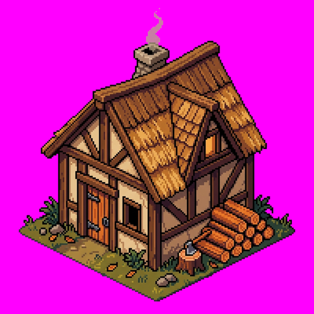
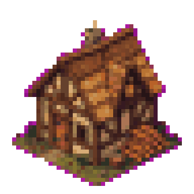

# Art pipeline (v0.3, after the review)

Goal: an **own** art pack (the "open pack") that reads as the same visual language as the 1996 original: 8-bit palette, soft pre-rendered-looking shading, frontal 3/4 view, tiny figures. It must use different designs, not copies. The original files from the player's own install stay the default pack. The open pack is what makes the game complete without them.

## 0. As built (2026-10-29)

The plan below (Blender, a locked palette, hand cleanup) was not needed for the open pack so far. What the game uses:

| Asset | How it is made | Where |
|---|---|---|
| Roman buildings (summer) | AI pictures from our own text prompts on a green background, no reference images, the original never named, made by our local generation scripts (not shipped; about 30 s a picture, three at a time). `tools/art/post.py` keys out the green (transparent answers are laid on green first; green enclosed by the building, such as a mill's lattice sails, is see-through too), crops, and scales to the size class at 1.5x the pixels | `assets/art/buildings/*.png`, `manifest.json` (`"source": "prompt"`) |
| Other peoples' buildings, winter pictures | our own SDF ray marcher: boxes, gables, cylinders, cones and lumpy rock with procedural materials (tiles and slates in courses, stone blocks and planks with a shade each, grime at the foot of walls), warm sun, cool sky light and ground bounce, soft shadows and ambient occlusion | `tools/art/prerender.py` (`--nation=N`, `--snow`), `"source": "prerender"` |
| Holy places of the Roman campaign (10 pictures: Jupiter's augur platform, Concordia's shrine, Juno's altar at Veii, Juno's temple on the Capitol, the gates of Janus closed and open, the Field of Mars, Neptune's cape shrine, Cybele's temple with the stone, Carthage's temple) | the same image tool as the Roman buildings, with "a sacred place" in place of "a building"; not used by the game yet (docs/CAMPAIGN-ROME.md) | `assets/art/holy/*.png`, `manifest.json` |
| Ships: a Roman merchant ship (corbita) in six headings, empty and loaded (12 pictures) | the same image tool, on a transparent background: the east-facing picture from the prompt alone, the other eleven with that picture attached as the only reference ("exactly the same ship, only its heading changes"), so all twelve show one ship; each heading its own picture, so the light comes from the upper left on all six (no mirroring). `tools/art/post_ship.py` cuts the hull at the waterline (the hull below it showed as a keel in the air), crops and scales; per picture a marks file gives the waterline, the main sail's four corners and the masthead (found from the tarred band and the sail's bright area, two sails set by hand) | `assets/art/ships/*.png`, `manifest.json`: size, anchor (the waterline's middle), `sail`, `mast`, `keel` (the waterline's ends: stern and bow) |
| Ship in the game | the picture for its heading, bobbing; under it a soft shadow, a dark line where the hull meets the water, foam at the bow and a soft, broken wake trailing from the stern along the hull's line; over it the owner's colour as a band across the sail (following its corners, with a thin edge) and a pennant at the masthead. No pictures: the drawn ship of before | `render.rs` (`draw_ship`), `ambience.rs` (`ship_water`) |
| Map life: wind, water, birds, footprints, worn earth and the rest | drawn by the game each frame and never stored: what lies still from the node's coordinates and what the game put there, what moves from the clock; footprints, the ground where soldiers fought and startled birds remembered beside the carriers' idle times (`Life`). Options → Calm map stops what moves | `crates/rr-app/src/ambience.rs` |
| Juno's geese, the birds of omen | lit vector shapes like the other animals (`animals::goose`, `animals::omen_bird`); in the gallery only until the gods are built | `crates/rr-app/src/animals.rs` |
| Trees, props | the same ray marcher | `tools/art/trees.py`, `props.py` |
| Terrain | procedural textures and meshes drawn each frame (blended edges, coasts with sand and surf, rivers, shallows) | `crates/rr-app/src/tex.rs`, `render.rs` |
| People, animals, donkeys | lit vector shapes drawn each frame: ellipses shaded from the upper left, one outline round the silhouette, tapered limbs with knees | `crates/rr-app/src/animals.rs`, `sprites.rs` |

To check sprites: `RR_GALLERY=1 tools/shot.sh out.png` draws every animal, figure and motion big, ten to a row. `RR_FRAMES=DIR:COUNT:FPS` films frame by frame into DIR on a fixed clock (the gallery with it, else the map: the same frames each run, for before/after clips). To redo a ship: its picture in the generation folder, its marks (waterline, sail corners, masthead) in that folder's marks file, then `post_ship.py <that folder> <marks file> assets/art/ships`. To redo a building:
delete its picture in the generation folder, change its prompt line if needed, run our local generation scripts
(not shipped) again, then `post.py <that folder> assets/art/buildings`. The generated originals are not in git.

## 1. What the first test showed

Asking an AI image tool for one building produced a usable concept picture in under a minute:

| Raw output (1024×1024, shown at 512) | Naive downscale to 48 px + 64 colors (shown ×8) |
|---|---|
|  |  |

The review's findings are visible here:
- The picture is in a **modern indie pixel-art style**: black outlines, a diamond 2:1 isometric base, a baked-in grass plate, and fake pixels that are not aligned to anything.
- The original look is different: no outlines, smooth shading, no ground plate, and a more frontal camera.
- Downscaling leaves **magenta fringes** from the background key, and the smoke is tinted pink.
- **Baked shadows** can't be separated from the building.
- There is **no player-color area** that could be masked.

Conclusion: the image tool is a great **concept and texture generator** and a poor **sprite generator**.

## 2. Pipeline

```
           ┌────────────── image tool ──────────────┐
 prompt →  │ concept sheets · tileable materials ·   │
 library   │ icon drafts · terrain base textures     │
           └───────────────┬────────────────────────┘
                           ▼
       Blender: low-poly kitbash / rigged base body, orthographic camera
       at the game angle, light from NW, render passes:
       color · material-ID (player color) · shadow catcher · anchors
                           ▼
       tools/art/post.py: render 4× → area downscale in OKLab →
       map to the LOCKED palette (fixed index ramps) → split player-color
       and shadow layers → trim → anchors from the scene → manifest
                           ▼
       hand cleanup (LibreSprite/Aseprite), contact sheet review
                           ▼
       data/art/  (PNG indexed + manifest.toml with provenance)
```

### 2.1 Where the image tool is used (and where not)
| Asset category | ≈ count | its role | Main tool |
|---|---|---|---|
| Buildings (1 nation) + construction stages + ruins | ~250 | concept sheets per building; tileable materials (thatch, timber, stone, plaster) | Blender kitbash, stages via height clip + scaffold |
| Carriers + ware overlays | ~1,800 | ware concept drafts | Blender rig with ware socket, auto-render 6 dirs × 8 frames |
| Job walk cycles | ~1,400 | head/tool concepts | same rig, mesh swaps |
| Work animations | ~800 | – | hand-keyed in Blender |
| Soldiers (5 ranks) | ~500 | armor concepts | rig + armor swaps |
| Animals, donkey, ships | ~800 | concepts | low-poly + simple rigs |
| Trees, stones, fields, decorations | ~400 | bark/leaf/rock textures | Blender (growth, sway, fall) |
| Terrain textures (3 landscapes) | 3 sheets | **seamless base textures** | quantize; procedural edge strips; water/lava procedurally into cycling indices |
| Ware / job / UI icons | ~400 | **drafts at 512 px** | hand pixel cleanup at 16–24 px, or render the 3D ware models |
| UI skin (frames, buttons, backgrounds) | ~100 | **wood/stone/parchment textures** | hand-built 9-slice |
| Fonts | ~600 glyphs | – (image models can't make bitmap fonts) | OFL pixel font base + hand edits, with umlauts |
| Loading screens, menu backgrounds, map preview art | ~20 | **direct** (big images are where AI shines) | light cleanup |

Effort for one complete nation (Roman-like): about **35–45 person-weeks**. This is a separate track that runs in parallel with the code. It is **not on the critical path of v1.0**, because v1.0 runs on the original files.

### 2.2 The locked palette (`data/art/palette.toml`)
256 entries, designed once, never per-image:
- 0: transparent. A dedicated shadow index (drawn as a darkening pass).
- **Player-color ramp:** 4 shades in one contiguous range (measure the original's range and size, as a fact, not its colors).
- **Water and lava cycle bands** (rotated by the renderer).
- Material ramps: wood, thatch, stone, plaster, skin, cloth, metal, foliage (3 seasons), grain, earth, snow.
- Every asset maps to it with a fixed OKLab nearest-color mapping. No dithering for units and buildings; ordered dithering for terrain only.

### 2.3 Prompt rules (legal and quality)
- Never name the original game, its publisher or "Settlers/Siedler" in a prompt.
- Describe the real-world reference instead: "Roman-era timber-frame sawmill, lime-plastered walls, red tile roof".
- Shared style prefix: *"soft pre-rendered 1990s look, no outlines, light from upper left, 3/4 frontal view from about 30° above, no ground plate, plain flat #00FF00 background"* (green key, which conflicts less with wood colors than magenta).
- Never give the image tool an image from the original as input (no img2img, no style reference).
- Run it in a folder with **no access to the original install** (separate user or container, only the output
  folder shared with it).

### 2.4 Provenance and review
- `data/art/manifest.toml` per sprite records: key, prompt id, model, date, Blender scene, `human_edited`, reviewer, and `similarity_check = "passed"`.
- A contact-sheet review page shows the candidate next to placeholders. A side-by-side with the original is allowed **only to reject near-copies**, never to tune towards one.
- License of the art pack: **CC-BY-SA-4.0** (only hand-edited parts are certainly protected; that is accepted).

## 3. Tools to build (in `tools/art/`)
| Tool | Does |
|---|---|
| `gen.py` | asks the image tool once per prompt entry into `out/<key>/<n>.png`, logs prompt and model |
| `post.py` | key removal with fringe cleanup (erode 1 px), OKLab downscale, palette mapping, layer split, trim, anchors |
| `blender/render_dirs.py` | renders 6 directions × N frames + ID and shadow passes from a scene with a fixed camera |
| `sheet.py` | builds contact sheets (HTML) for review |
| `pack.py` | builds atlases + `manifest.toml` for the open art pack |

## 4. First art milestone (A1, parallel to R1–R3)
1. Palette v1 + style bible (with measured sizes from the original, numbers only).
2. One building end to end: woodcutter's hut (concept by the image tool → Blender → post → in-game next to the original).
3. One carrier walk cycle in 6 directions with 3 wares.
4. One terrain set (meadow, mountain, water) with edges.

Done when: the hut, the carrier and the terrain sit in the running game, look consistent at 1× zoom, and need no explanation of "AI art" to a viewer.
